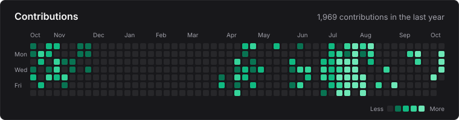
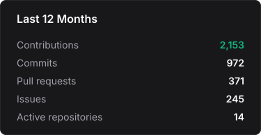
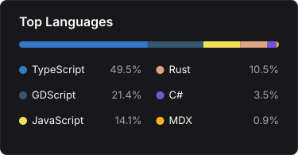
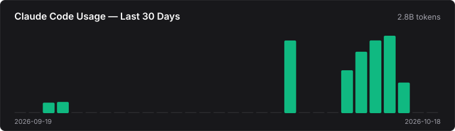

<h1 align="center">Hi, I'm Crawford Young 👋</h1>

  AI/Software Engineer at Aderant &nbsp;·&nbsp; Auburn CS Grad

  
  &nbsp;
  

---

### About Me

- 🎓 BS Computer Science · Undergraduate Certificate in AI Engineering · Honors Scholar
- 💼 Software Engineer at Aderant
- 🏆 Ex-Web Dev Club President · Ex-Competitive Programming Team Member · Ex-FloQast Intern

---

### GitHub Stats

  

  
  

  

All cards generated daily by <a href="./src">our own code</a> — no third-party image services.

---

### Tech Stack

  <b>Web</b>&nbsp;
  
  
  
  
  
  
  
  

  <b>Apps</b>&nbsp;
  
  
  
  

  <b>Games</b>&nbsp;
  
  

  <b>AI + tools</b>&nbsp;
  
  
  
  
  

---

### Currently Working On

| Project | What | Stack |
|---|---|---|
| [strate](https://github.com/Crawford-Young/strate) | Desktop app for watching and steering Claude Code agents live | Rust · Tauri · TypeScript |
| [@crawfordyoung/ui](https://github.com/Crawford-Young/component-library) · [live](https://ui.crawfordyoung.dev) | React component library | Radix UI · Tailwind CSS · CVA |
| [claude-config](https://github.com/Crawford-Young/claude-config) | Personal Claude Code harness: skills, hooks, agent orchestration | Node.js |
| [Dog Eat Dog](https://github.com/Crawford-Young/dog-eat-dog) | Cozy office game — a chibi dog climbs the corporate ladder | Godot 4 · GDScript |
| [What Is Dark](https://github.com/Crawford-Young/what-is-dark) | First-person parkour with Source-style movement | Godot 4 · GDScript |
| [MetroDuel](https://github.com/Crawford-Young/metroduel) | iOS rhythm-battle game | Expo · React Native |
| [Creator Coach](https://github.com/Crawford-Young/creator-coach) · [live](https://creator-coach.crawfordyoung.dev) | AI creator coaching companion | Next.js · MongoDB |
| [CarsickYak site](https://github.com/Crawford-Young/carsickyak-site) · [live](https://carsickyak.crawfordyoung.dev) | CarsickYak hub: live Twitch status, YouTube feeds | Next.js |

---

### Other Projects

| Project | Description |
|---|---|
| [Instrument Tuner](https://github.com/Crawford-Young/InstrumentTuner) · [live](https://music.crawfordyoung.dev) | Browser chromatic tuner, metronome and tempo duel |
| [Portfolio Website](https://github.com/Crawford-Young/portfolio-website) · [live](https://crawfordyoung.dev) | Personal portfolio at crawfordyoung.dev |
| [Cybond](https://github.com/Crawford-Young/scheduling-advisor) | AI scheduling assistant (archived) |
